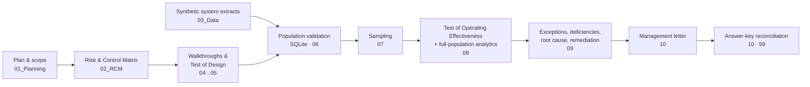

# NovaLend ITGC Audit — End-to-End IT General Controls Audit (Simulated)

> **Simulated project.** NovaLend Finance Pvt. Ltd. is a **fictional company** created for an ITGC audit learning project. Every person, system, record and result in this repository is synthetic. No real company, client or personal data is used.

An end-to-end IT General Controls (ITGC) audit of **LendCore**, the loan management system of a fictional Mumbai-based lender, for the financial year **1 April 2025 – 31 March 2026**.

The project follows the same lifecycle as a real ITGC engagement: planning and scoping, risk assessment, a Risk and Control Matrix (RCM), walkthroughs and test of design, population validation (IPE), reproducible sampling, test of operating effectiveness, full-population data analytics, deficiency evaluation, root cause analysis, and a management letter. The audit data is generated in Python with deliberately planted control failures, and the audit results are reconciled to a sealed answer key at the end.

---

## Results at a glance

| Measure | Result |
|---|---|
| ITGC domains covered | Access to programs and data · Program change · Program development (SDLC) · Computer operations |
| Controls in the RCM | 15 (12 key) |
| Controls operating effectively | 2 of 15 |
| Exceptions identified | 18 |
| Findings reported | 10 (3 High, 6 Medium, 1 Low) |
| Deficiency classification | 3 significant deficiencies, 7 control deficiencies, no material weakness within scope |
| Answer-key reconciliation | 18 of 18 planted exceptions found, 0 false positives |
| Found by sampling or 100% testing | 7 |
| Found **only** by full-population analytics | 11 |

**Key lesson:** random samples of the seven sampled controls found **no** exceptions. Re-running the same tests on every record found 11, including an unauthorised deployment to the interest calculation and a leaver's account used after they left. Sampling alone would have produced the wrong conclusion on change management.

---

## Audit workflow



---

## Repository structure

| Folder | What it contains |
|---|---|
| `00_Admin/` | `Glossary.md` — plain-English definitions of every audit term used |
| `01_Planning/` | System description (with data-flow diagram) and audit plan: objective, scope, criteria, risk assessment, approach, timeline |
| `02_RCM/` | `NovaLend_RCM.xlsx` — risk register (inherent risk scoring) and 15-control RCM with test approach and results |
| `03_Data/` | `generate_data.py` and 13 synthetic CSV system extracts (HR, LendCore users, access tickets, privileged users, access reviews, change tickets, deployment log, SDLC records, backups, restore tests, batch jobs, incidents, record counts) |
| `04_Walkthroughs/` | Walkthrough documentation for all four domains, each tracing a real record end to end |
| `05_Test_of_Design/` | Test of design workpaper — 14 controls designed effectively, 1 design gap |
| `06_Population_Validation/` | `validate_populations.py` (SQLite + SQL) and the population validation workpaper; control populations in `populations/` |
| `07_Sampling/` | `select_samples.py` and the sampling workpaper; selected samples in `samples/` |
| `08_Test_of_Operating_Effectiveness/` | `test_controls.py` and the ToE workpaper (attribute testing + full-population analytics) |
| `09_Exceptions_and_Deficiencies/` | Exception log (Condition → Criteria → Cause → Impact → Recommendation), deficiency evaluation, remediation tracker |
| `10_Reporting/` | Management letter (PDF and Word), answer-key reconciliation script, workbook and reflection |
| `99_Answer_Key_SEALED/` | The list of planted exceptions, opened only at the reconciliation step |

Word documents are also saved as PDF so they can be read directly on GitHub.

---

## How to run

Requires Python 3.10+.

```bash
pip install -r requirements.txt

python run_all.py            # generate data -> validate -> sample -> test -> reconcile
python run_all.py --no-key   # stop before the answer-key comparison
```

Each step can also be run on its own:

```bash
python 03_Data/generate_data.py
python 06_Population_Validation/validate_populations.py
python 07_Sampling/select_samples.py
python 08_Test_of_Operating_Effectiveness/test_controls.py
python 10_Reporting/reconcile_answer_key.py
```

The data seed (`SEED = 2025`) and sampling seed (`RANDOM_SEED = 20260515`) are fixed, so the outputs are reproducible.

**Blind practice:** change `SEED` in `03_Data/generate_data.py` to create a brand-new dataset, run `python run_all.py --no-key`, investigate the exceptions yourself, and only then run the reconciliation.

---

## Methodology highlights

- **Risk-based planning.** Fifteen risks written as *event – cause – consequence* and scored for inherent risk (likelihood × impact) before any controls were considered.
- **Population completeness (IPE).** Every extract was loaded into SQLite and checked for record counts against the source system, duplicate keys, blank mandatory fields and full date coverage. The change population was taken from the **system-generated deployment log**, not the ticket list — which is how a deployment with no ticket was found.
- **Reproducible sampling.** Sample sizes follow a documented, simplified frequency table; items are selected randomly with a fixed seed so a reviewer can reproduce the sample.
- **Attribute testing.** Each control has two to four attributes (e.g. *ticket exists · approved by line manager · approved before access granted · role matches request*). Any failed attribute is an exception.
- **Full-population analytics.** The same test functions are re-run on every record of each sampled population, showing exactly what sampling missed.
- **Deficiency evaluation.** Exceptions assessed for magnitude, likelihood, compensating controls and aggregation, classified as control deficiency, significant deficiency or material weakness, with 5-whys root cause analysis.
- **Reporting.** Risk-rated findings with management responses, owners and target dates, tracked in a remediation tracker.

---

## Skills demonstrated

**IT audit:** ITGC testing · Risk and Control Matrix · test of design and operating effectiveness · walkthroughs · audit sampling · IPE / population completeness and accuracy · exception documentation · deficiency evaluation · root cause analysis · compensating controls · management letter writing · remediation tracking

**Control areas:** user access provisioning and de-provisioning · user access reviews · privileged access · segregation of duties · change management · emergency changes · SDLC / go-live controls · backup and restore · batch job monitoring · incident management

**Frameworks referenced:** ICFR deficiency classification (simplified, with reference to PCAOB AS 2201 and the ICAI Guidance Note on Audit of Internal Financial Controls)

**Tools:** Python (pandas, Faker) · SQL (SQLite, JOINs, CTEs, GROUP BY) · Excel (formulas, data validation, conditional formatting) · Word · Git/GitHub

---

## Simplifications and limitations

- NovaLend is smaller and cleaner than a real company, and the data is synthetic.
- Evidence that would normally be inspected (screenshots, emails, ticket history) is represented by fields in the extracts.
- Extract completeness relies on record counts reported by each system; in practice the auditor would observe or re-perform the report.
- Sample sizes, risk scales and deficiency definitions are simplified versions of real firm methodologies.
- Walkthrough interviews, root causes and management responses are simulated.
- Business days are Monday to Friday; public holidays are ignored.

---

*Prepared by Manjit Mandal as a self-directed learning project. NovaLend Finance Pvt. Ltd. and all associated data are fictional.*
